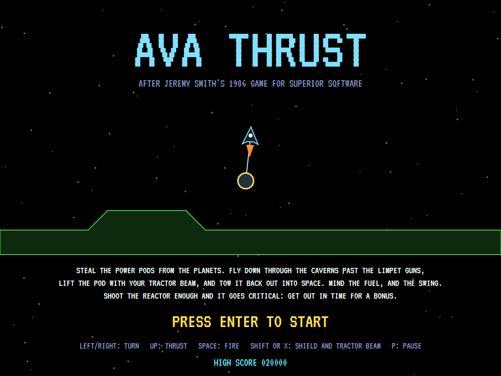
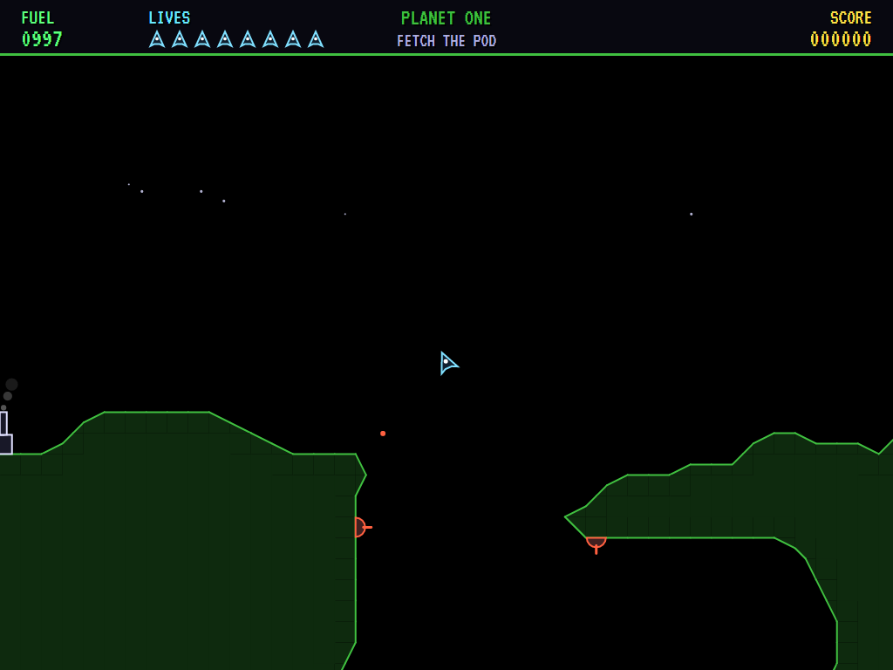
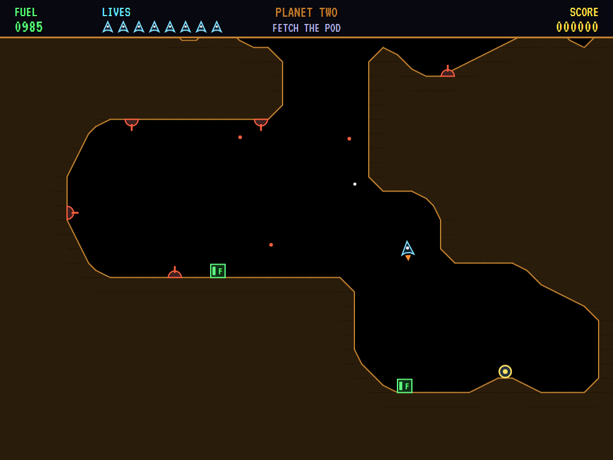
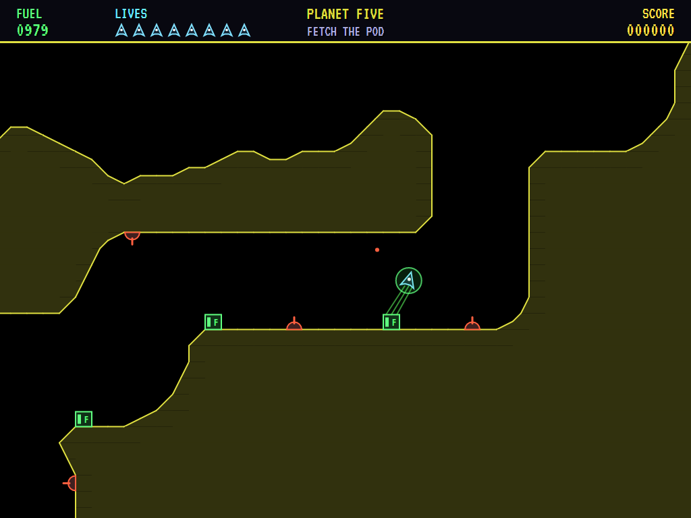
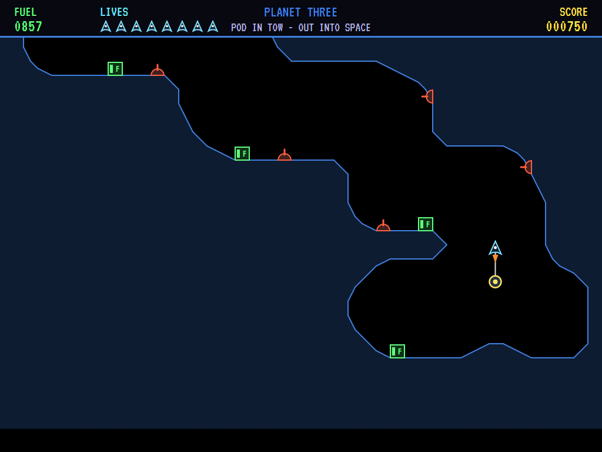
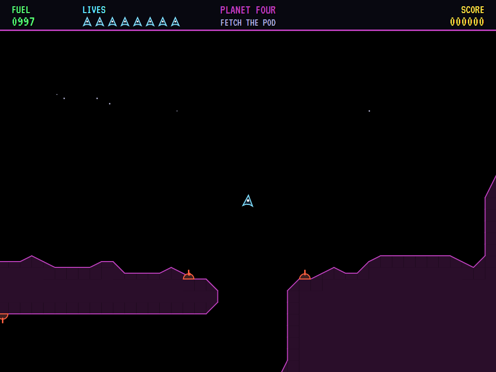
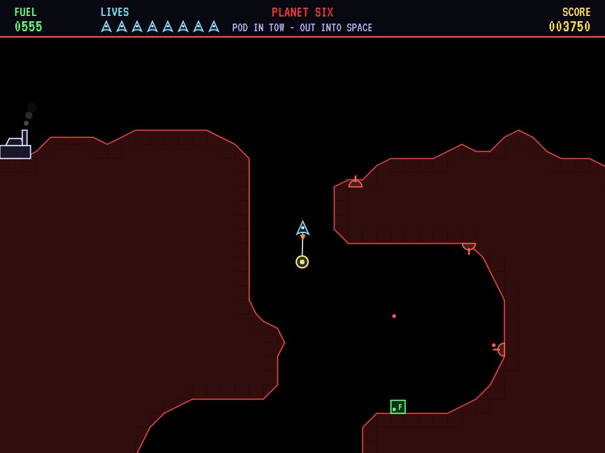
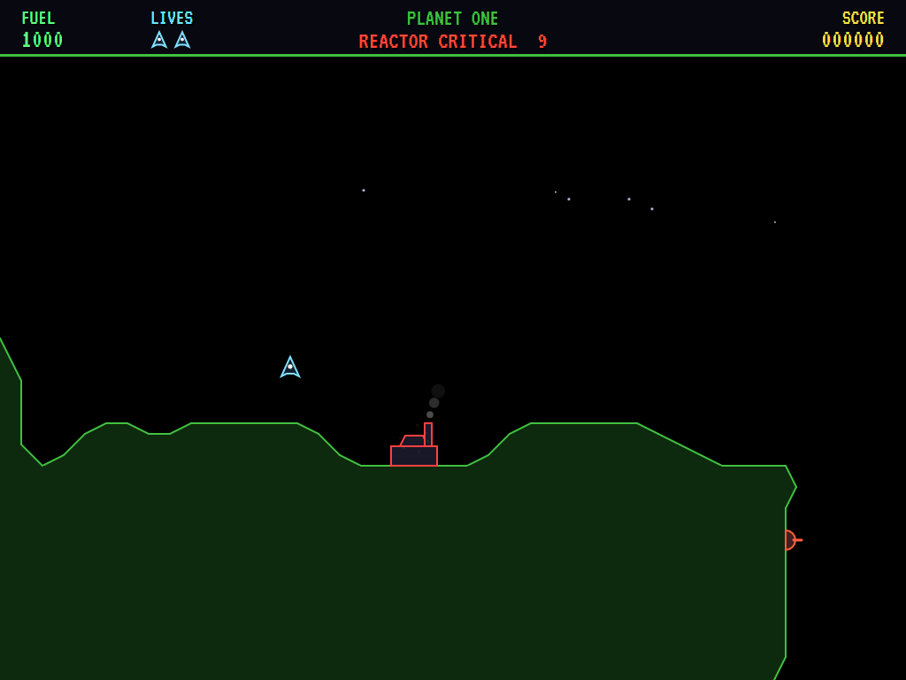
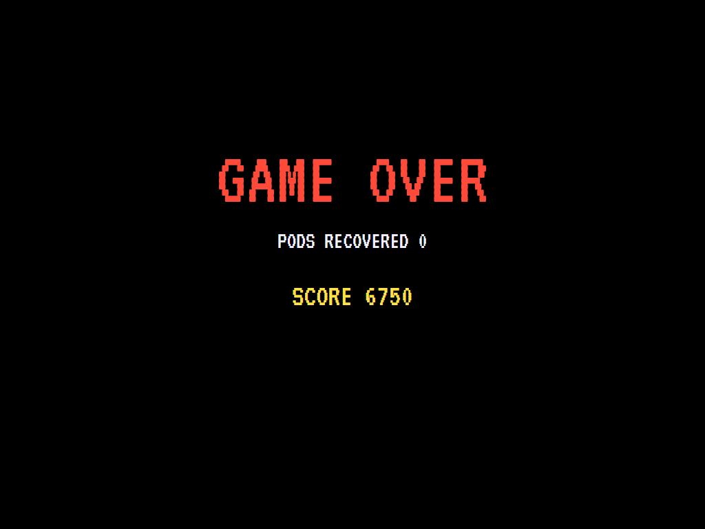
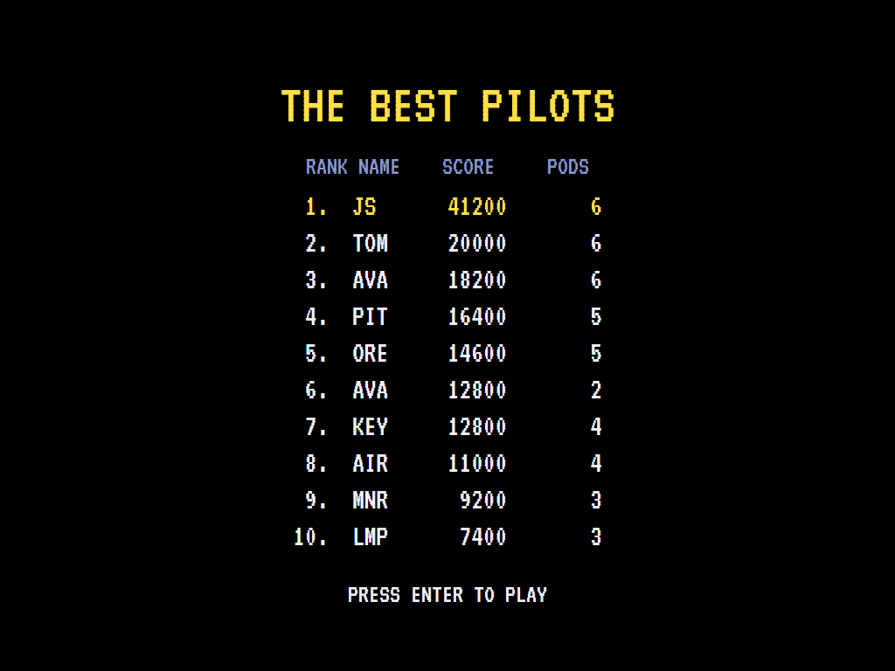

# AVA Thrust

[](https://github.com/Harlock123/AVAThrust/actions/workflows/build.yml)

A gravity-and-inertia cave flyer, in the style of Jeremy Smith's 1986 game **Thrust** for Superior Software. It's
built with .NET 10 and Avalonia UI. Turn and thrust your ship down through each planet's caverns, past the limpet
guns. Lift the pod off its pedestal with the tractor beam and tow it back up and out into space, swinging on its
rod beneath you. Watch the fuel, and the swing.

## Features

- **Real physics.** The ship turns and fires its thruster against gravity, and keeps its momentum. The pod hangs
  on a rigid rod that shares the thrust between them. It's heavier than the ship, and it swings. Touch rock
  with either and they're lost.
- **The tractor beam,** on the same key as the shield. It lifts the pod (the rod eases out to its full length
  as the pod leaves its pedestal) and draws fuel up from the tanks.
- **Limpet guns** on the rock faces fire at a ship they can see. Shoot them for points, or raise the shield.
- **The reactor.** Each hit silences the guns for a while. Hit it enough and it goes critical: ten seconds to
  get out with the pod, for a bonus. Stay and the planet goes up with you.
- **Six planets,** each deeper, with stronger gravity and more guns. Every planet is built from a seed. The
  rock's edges are cut at forty-five degrees, the way the planets looked, and the same edges are used for
  collisions. A planet is kept only if there's room for the ship to fly down to the pod and back out with the
  pod swinging below.
- **Fuel** is spent by the thruster and the shield. Every new ship, and every new planet, starts with a full
  tank.
- **The attract mode** shows the computer pilot at work. It plans a way through the caverns square by square
  and flies it, turning the ship to point its thrust where it's needed. It refuels when it needs to and picks
  the pod up once it's almost still. Towing, it tries a spread of ways on, plays each out on a copy of the
  planet, and takes the one that gets furthest without the pod touching rock. It raises the shield against
  shots, and fires at any gun in its sights.

## Screenshots

| The title | Over the planet | Down the shaft |
|:---------:|:---------------:|:--------------:|
|  |  |  |
| A ship and its pod. | The reactor, and the way in. | Down into the caverns. |

| Fuel | Lifting the pod | Limpet guns |
|:----:|:---------------:|:-----------:|
|  |  |  |
| The tractor beam drawing fuel. | Off its pedestal. | On the rock faces. |

| Towing out | Reactor critical | Game over |
|:----------:|:----------------:|:---------:|
|  |  |  |
| Up the last shaft with the pod. | Ten seconds to get clear. | |



The screenshots are made by the tests, which play the game in a real (headless) window; see
[Tests](#tests).

## Download and run

Ready-to-run builds for Windows, macOS and Linux, on both Intel/AMD and ARM, are on the
[Releases page](https://github.com/Harlock123/AVAThrust/releases/tag/latest). **Latest build** is
rebuilt on every push to `main`. Each download is one self-contained executable: no .NET install is
needed.

| Platform | Archive |
|---|---|
| Windows | `AVAThrust-win-x64.zip`, `AVAThrust-win-x86.zip`, `AVAThrust-win-arm64.zip` |
| macOS | `AVAThrust-osx-arm64.tar.gz` (Apple silicon), `AVAThrust-osx-x64.tar.gz` (Intel) |
| Linux | `AVAThrust-linux-x64.tar.gz`, `AVAThrust-linux-arm64.tar.gz`, `AVAThrust-linux-arm.tar.gz` |

```bash
tar -xzf AVAThrust-linux-x64.tar.gz     # or linux-arm64, linux-arm, osx-arm64, osx-x64
./AVAThrust
```

On Windows, unzip and run `AVAThrust.exe`. On macOS, if Gatekeeper refuses to open it, run
`xattr -d com.apple.quarantine AVAThrust` once. Run with `--no-audio` for silence.

**Sound** comes through OpenAL Soft, built in for every platform. In a virtual machine the game
detects it and uses a larger audio buffer, so the sound doesn't break up.

**Gamepads** use SDL2, which is bundled for Windows, macOS and Intel/AMD Linux. ARM Linux builds need it
installed; without it the keyboard still works:

```bash
sudo apt install libsdl2-dev            # Debian / Ubuntu / Raspberry Pi OS
sudo pacman -S --needed sdl2-compat     # Arch / Omarchy
```
## Controls

| Action | Keyboard | Gamepad |
|---|---|---|
| Start | Enter or 1 | Start |
| Turn | Left/right arrows (or A/D) | Left stick / D-pad |
| Thrust | Up arrow (or W) | Up |
| Fire | Space, Z or Ctrl | A or right trigger |
| Shield and tractor beam | X or Shift | B, X or left trigger |
| Pause | P or Esc | Start or Back |
| Sound on/off | M | |
| Screenshot | Ctrl+S (to your Pictures folder) | |

On the high-score table, type your initials, or use up/down and Space, then Enter.

## Tests

```bash
dotnet test AVAThrust.slnx
```

The game runs in fixed 60 Hz steps, so it plays the same at any frame rate. Everything that moves lives in
one world that can be copied. The tests check:

- **The planets:** room down to the pod and back up towing it; each deeper, with stronger gravity and more
  guns; the pod on its pedestal, the reactor on the surface and the fuel on floors; guns standing on rock and
  pointing into the open; corners cut at forty-five degrees; the same planet every time.
- **Flying:** gravity, and thrust the way the ship points; turning; fuel burned by the thrust and the shield,
  and no thrust without it; rock is a crash.
- **The pod and the fuel:** the tractor beam lifting the pod, which swings on its rod; the pod making the ship
  heavier; the pod against rock lost with the ship, and back on its pedestal; fuel drawn from a tank.
- **Guns, shots and the reactor:** a gun firing at a ship it can see, and the shield turning shots away; a
  shot taking out a gun; reactor hits silencing the guns, and enough of them setting off the countdown.
- **The game:** out with the pod for the bonus and the next planet; out without it is mission incomplete;
  ships lost and game over; the demonstration; pause; the keys.

`tests/AVAThrust.Tests/PilotProbe.cs` reports how the computer pilot gets on on each planet, for tuning
(`THRUST_PROBE=1`). It gets every pod out, mostly without losing a ship. `THRUST_PROBE=lazy` turns and
thrusts at random and never gets one.

The screenshot tests draw the real screen in a headless window. To refresh the README's pictures:

```bash
THRUST_SHOTS=$PWD/Images dotnet test tests/AVAThrust.Tests --filter ScreenshotTests
```

## Building

```bash
dotnet build AVAThrust.slnx
dotnet run --project src/AVAThrust
```

Needs the .NET 10 SDK. The sounds, tunes and voice are made by `tools/make_sounds.py` (standard-library
Python, with the formant voice in `tools/speech.py`): `python3 tools/make_sounds.py` rewrites
`src/AVAThrust/Sounds`. Both tunes are new compositions.

## Project structure

```
AVAThrust/
├── AVAThrust.slnx
├── src/AVAThrust/
│   ├── Engine/
│   │   ├── GameEngine.cs        # States, ships, planets in turn, bonuses, the title and demonstration
│   │   ├── Sim.cs               # A planet step by step: flying, the rod, the tractor beam, guns, the reactor
│   │   ├── World.cs             # The ship, the pod and everything that moves, kept together so it can be copied
│   │   ├── Planet.cs            # The rock and where everything is, built from seeds and proved flyable
│   │   ├── Pilot.cs             # The computer pilot (the demonstration, and the tests)
│   │   ├── HighScoreTable.cs, InitialsEntry.cs
│   │   ├── InputHandler.cs, ControllerManager.cs  # Keys and an SDL2 gamepad
│   │   └── SoundManager.cs      # Effects, tunes and voice through OpenAL
│   ├── Audio/                   # The OpenAL engine (from the author's AVABand)
│   ├── Views/GameCanvas*.cs     # The planet in outline, the ship and pod, the strip along the top, the title
│   └── Sounds/                  # The synthesised effects, tunes and voice
├── tests/AVAThrust.Tests/       # Planet, gameplay and screenshot tests
├── tools/make_sounds.py, tools/speech.py
└── Images/                      # Screenshots
```

## About and licence

AVA Thrust © 2026 Lonnie Watson, under the [MIT License](LICENSE).

*Thrust* © 1986 Superior Software (written by Jeremy Smith); the name *Thrust* belongs to its current owner. AVA
Thrust is an independent, unofficial game in its style. Its planets, graphics, sounds, tunes and code are its
own; nothing is taken from the original game's program, graphics or sound. It is not affiliated with or
endorsed by any rights holder.
